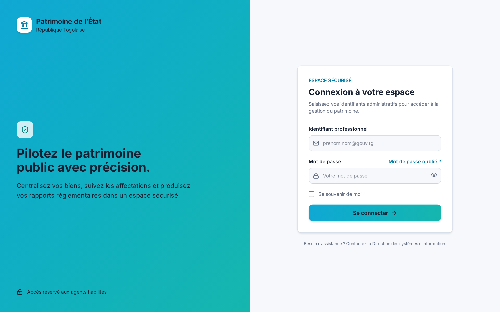
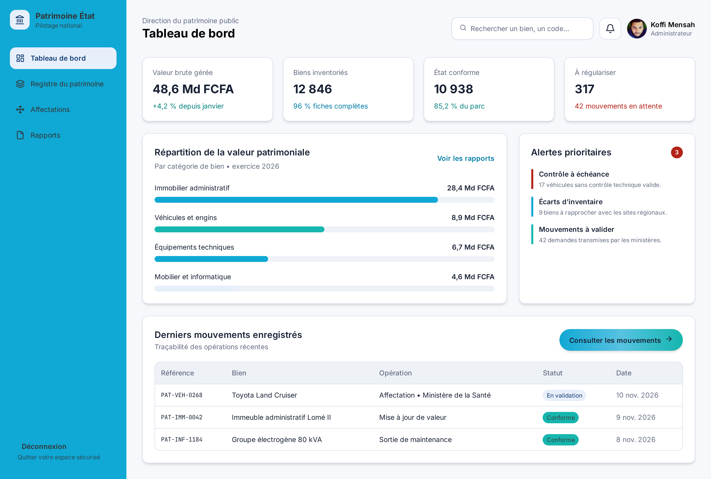
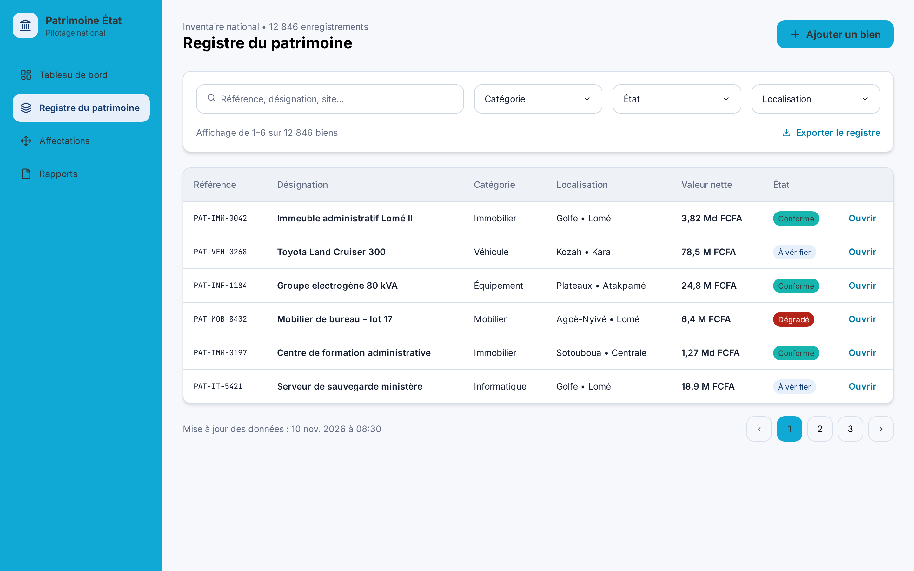
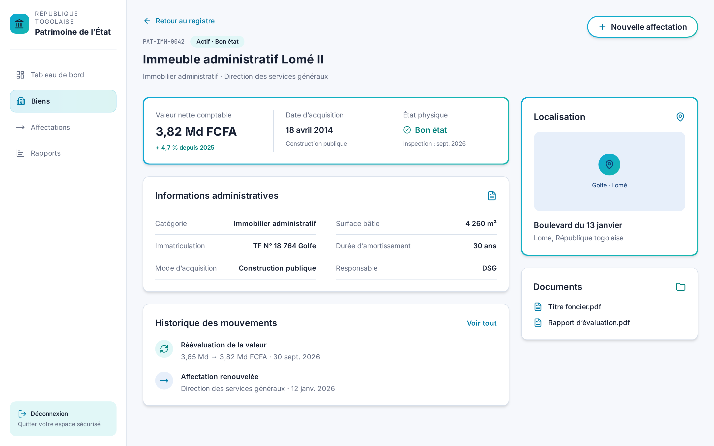
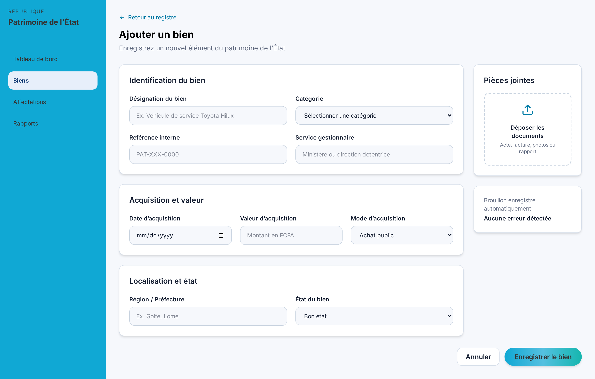
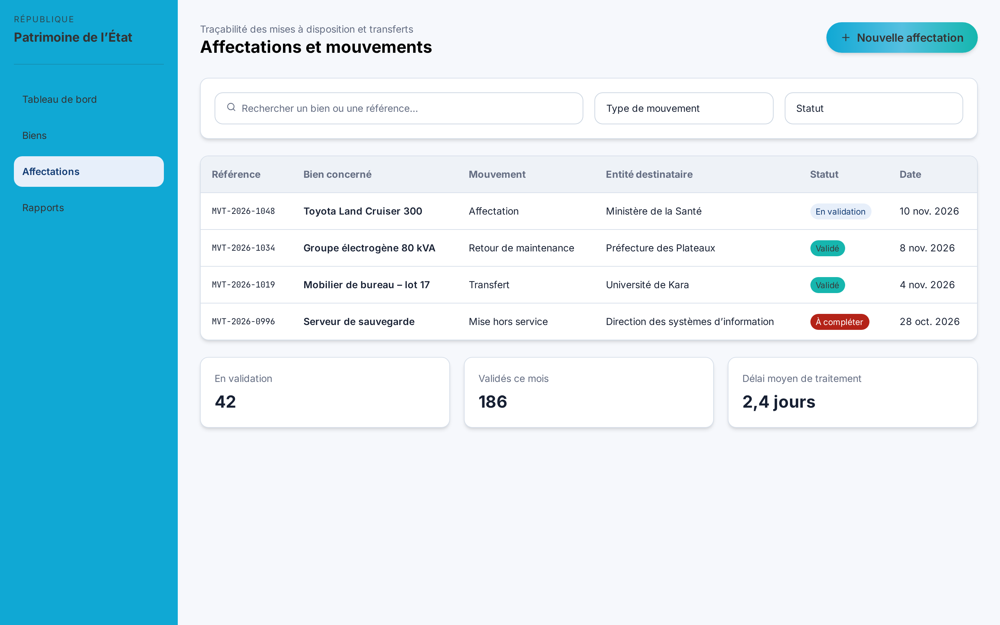
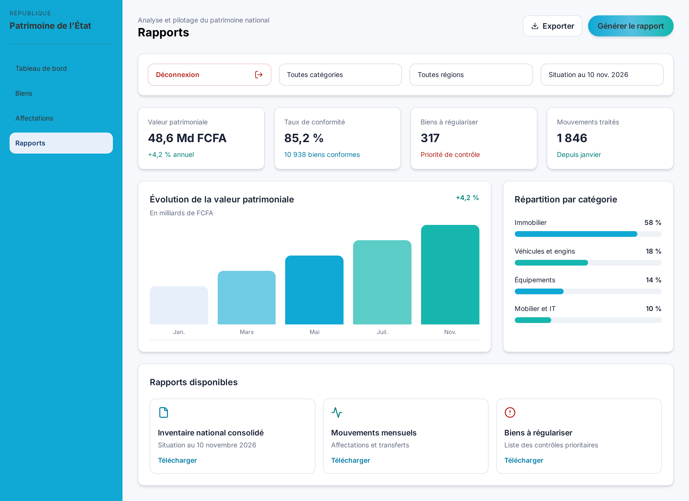

# 📘 Guide d'utilisation - Gestion du Patrimoine de l'État

Ce guide explique comment utiliser la plateforme déployée sur Render.

---

## 🌐 Accès à la plateforme

**URL publique :** `https://auth-service-urmp.onrender.com`

> ⚠️ **Note importante :** Le plan gratuit de Render met le service en veille après 15 minutes d'inactivité. La première fois que vous ouvrez le lien, le chargement peut prendre **50 secondes** (le temps que le serveur redémarre). C'est normal. Les fois suivantes, c'est instantané.

---

## 🔐 1. Se connecter

1. Ouvrez l'URL : `https://auth-service-urmp.onrender.com`
2. Vous arrivez sur la **page de connexion**.
3. Utilisez les identifiants de test fournis ci-dessous.

**Comptes de test :**

| Email | Mot de passe | Rôle |
|---|---|---|
| `admin@gouv.tg` | `password` | Administrateur |

*(Cliquez sur "Se connecter" pour accéder au tableau de bord).*

---

## 📊 2. Tableau de bord

Une fois connecté, vous arrivez sur le **Tableau de bord**. Il affiche :

- **4 indicateurs clés (KPI) :**
  - Valeur brute gérée (48,6 Md FCFA)
  - Biens inventoriés (12 846)
  - État conforme (10 938)
  - À régulariser (317)
- **Répartition de la valeur patrimoniale** (graphique avec barres de progression).
- **Alertes prioritaires** (3 alertes avec barres de couleur).
- **Derniers mouvements enregistrés** (tableau avec les 3 dernières opérations).

**Actions possibles :**
- Cliquer sur **"Voir les rapports"** → redirige vers la page Rapports.
- Cliquer sur **"Consulter les mouvements"** → redirige vers la page Affectations.
- Utiliser la **barre de recherche** en haut à droite → tapez un mot-clé (ex: "Toyota") et appuyez sur Entrée → vous êtes redirigé vers le Registre filtré.

---

## 📋 3. Registre du patrimoine

Cette page affiche la **liste de tous les biens** de l'État.

**Fonctionnalités :**
- **Recherche :** tapez une référence, une désignation ou une ville dans la barre de recherche, puis cliquez sur "Rechercher" pour filtrer les résultats.
- **Pagination :** les biens sont répartis sur plusieurs pages (3 biens par page). Utilisez les boutons **1, 2, 3** ou les **flèches** `<` et `>` pour naviguer.
- **Ouvrir un bien :** cliquez sur le lien **"Ouvrir"** à droite de chaque ligne pour voir la fiche détaillée.
- **Exporter :** cliquez sur **"Exporter le registre"** pour télécharger un fichier CSV contenant tous les biens.
- **Ajouter un bien :** cliquez sur le bouton **"+ Ajouter un bien"** en haut à droite.

---

## 🏛️ 4. Fiche d'un bien

En cliquant sur **"Ouvrir"** depuis le Registre, vous accédez à la fiche détaillée du bien. Elle contient :

- **Valeur nette comptable** (avec bordure dégradée cyan).
- **Date d'acquisition** et **état physique**.
- **Informations administratives** (catégorie, surface, immatriculation, etc.).
- **Localisation** (carte avec la punaise).
- **Documents** (Titre foncier.pdf, Rapport d'évaluation.pdf) → cliquer dessus pour télécharger.
- **Historique des mouvements** (réévaluations, affectations).

**Actions possibles :**
- Cliquer sur **"Nouvelle affectation"** → redirige vers le formulaire d'affectation.
- Cliquer sur **"Retour au registre"** → revenir à la liste.

---

## ➕ 5. Ajouter un bien

Le formulaire d'ajout permet d'enregistrer un nouveau bien dans le patrimoine.

**Champs à remplir :**
- Désignation du bien
- Catégorie
- Référence interne (ex: PAT-XXX-0000)
- Service gestionnaire
- Date d'acquisition
- Valeur d'acquisition
- Mode d'acquisition
- Région / Préfecture
- État du bien

**Actions possibles :**
- **Pièces jointes :** cliquez sur la zone "Déposer les documents" pour sélectionner un fichier.
- **Enregistrer :** cliquez sur **"Enregistrer le bien"** → vous êtes redirigé vers le Registre avec un message de succès.
- **Annuler :** cliquez sur **"Annuler"** → retour au Registre sans enregistrer.

---

## 🔄 6. Affectations et mouvements

Cette page affiche la **traçabilité des mouvements** (affectations, transferts, maintenances).

**Fonctionnalités :**
- **Recherche :** tapez un mot-clé (ex: "Toyota") et cliquez sur "Rechercher" pour filtrer.
- **Tableau :** affiche la référence, le bien concerné, le type de mouvement, l'entité destinataire, le statut et la date.
- **Cartes de résumé :** 3 cartes en bas (En validation, Validés ce mois, Délai moyen).
- **Nouvelle affectation :** cliquez sur le bouton **"+ Nouvelle affectation"** en haut à droite.

---

## ➕ 7. Nouvelle affectation

Le formulaire permet d'enregistrer un nouveau mouvement.

**Champs à remplir :**
- Bien concerné (liste déroulante)
- Type de mouvement (Affectation, Transfert, etc.)
- Entité destinataire
- Date du mouvement
- Notes (optionnel)

**Actions possibles :**
- **Enregistrer :** cliquez sur **"Enregistrer"** pour valider le mouvement.
- **Annuler :** cliquez sur **"Annuler"** pour revenir à la page Affectations.

---

## 📈 8. Rapports

Cette page affiche les **statistiques et les rapports** de l'application.

**Fonctionnalités :**
- **4 cartes KPI** (Valeur patrimoniale, Taux de conformité, Biens à régulariser, Mouvements traités).
- **Graphique "Évolution de la valeur patrimoniale"** (barres verticales).
- **Graphique "Répartition par catégorie"** (barres horizontales).
- **Rapports disponibles :** 3 blocs avec des boutons "Télécharger" (Inventaire national, Mouvements mensuels, Biens à régulariser).
- **Boutons en haut :** "Exporter" (télécharge un CSV) et "Générer le rapport".

---

## 🚪 9. Déconnexion

Pour vous déconnecter, cliquez sur le bouton **"Déconnexion"** en bas de la barre latérale (sidebar). Vous serez redirigé vers la page de connexion.

---

## ✅ Récapitulatif des fonctionnalités

| Page | Fonctionnalité |
|---|---|
| Connexion | Authentification sécurisée (email + mot de passe) |
| Tableau de bord | KPI, graphiques, alertes, derniers mouvements |
| Registre | Liste des biens, recherche, pagination, export CSV |
| Fiche bien | Détails, documents, historique des mouvements |
| Ajouter un bien | Formulaire complet avec pièces jointes |
| Affectations | Traçabilité des mouvements, recherche |
| Nouvelle affectation | Formulaire de création de mouvement |
| Rapports | Statistiques, graphiques, export CSV |

---

## 🛠️ Notes techniques

- **Technologie :** Laravel 12 (PHP 8.3), PostgreSQL, Docker.
- **Hébergement :** Render (plan gratuit).
- **Base de données :** PostgreSQL (Neon/Render).
- **Données :** Les 6 biens sont chargés en données statiques dans le contrôleur (`RegistreController`) pour assurer la fluidité sur le plan gratuit de Render.

---

**Fin du guide d'utilisation.**